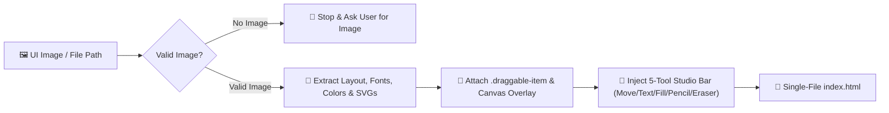

# Image to Interactive HTML (`image-to-interactive-html`)

> **Turn any static UI screenshot or mockup into a single-file, zero-dependency Interactive UI Studio where every visual element can be freely dragged, edited inline (text), recolored (paint bucket), and annotated (pencil & eraser).**

[](#-installation)
[](#-key-features)
[](#-5-in-1-interactive-studio-tools)
[](#1-strict-input-validation-guardrail)
[](./LICENSE)

[Why This Exists](#-why-this-exists) · [5-in-1 Studio Tools](#-5-in-1-interactive-studio-tools) · [How It Works](#-how-it-works) · [Installation](#-installation) · [Usage & Prompts](#-usage--prompts) · [Repository Structure](#-repository-structure) · [ภาษาไทย (Thai Guide)](#-คู่มือการใช้งานภาษาไทย)

---

## 🎯 Why This Exists

When asking an AI coding agent to convert a UI screenshot into HTML/CSS, traditional prompts give you a **static layout**. If a badge is 8px too low, a button needs a different color, copywriting feels too long, or you want to sketch visual feedback over the mockup, you have to go back and forth prompting the AI blindly.

**`image-to-interactive-html`** solves this by turning any reference image into an **Interactive UI Studio in a single `.html` file**:
1. **Pixel-Faithful Extraction:** Replicates exact colors, typography (including Thai fonts like `Prompt`/`Sarabun` and English `Inter`), inline SVG icons, shadows, and border radii.
2. **🖐️ Move (Independent Drag & Drop):** Drag any button, badge, heading, icon, or parent card independently with live `(X, Y)` pixel coordinates.
3. **🔤 Text (Inline Text Editing):** Click any heading, paragraph, button label, or badge to rewrite copy directly on screen (`contenteditable="true"`).
4. **🪣 Fill (Paint Bucket):** Pick any color and click any UI element (or background) to recolor its background (`Click`) or text color (`Shift + Click`).
5. **✏️ Pencil & 🧹 Eraser:** Sketch freehand annotations, arrows, or wireframe notes right on top of the prototype using a full-viewport transparent HTML5 `<canvas>` overlay, and erase strokes cleanly.

---

## 🛠️ 5-in-1 Interactive Studio Tools

| Studio Tool | Action | Shortcut / Tip |
| :--- | :--- | :--- |
| **🖐️ Move** | Drag & reposition any UI element independently (`e.stopPropagation()`). | Double-click any element in Move mode to quick-edit its text! |
| **🔤 Text** | Inline live editing for headings, buttons, badges, and paragraphs. | Click outside (`blur`) or switch tools to lock in changes. |
| **🪣 Fill (ถังสี)** | Click any element or page background to fill its background color. | Hold **`Shift + Click`** to change the element's **text color** instead. |
| **✏️ Pencil (ดินสอ)** | Draw freehand annotations, arrows, or notes over the UI canvas. | Adjust color via Color Picker and thickness via the Size Slider. |
| **🧹 Eraser (ยางลบ)** | Smoothly rub out drawn pencil strokes (`destination-out`). | Adjust eraser width using the same Size Slider. |
| **🔄 Reset** | Restores all positions to `(0, 0)`, resets original colors & text, and clears drawings. | Smooth cubic-bezier animation back to initial layout. |

---

## ⚙️ How It Works



### 1. Strict Input Validation (Guardrail)
If you invoke the skill with text only and forget to attach an image or specify a local image path (`.png`, `.jpg`, `.jpeg`, `.webp`, `.gif`), the agent **stops immediately** instead of inventing a random layout.

### 2. Visual Extraction & Fidelity
The agent inspects the image to match viewport backgrounds, card dimensions, border radii, drop shadows, exact hex/RGB values, and appropriate Google Fonts (`Inter`, `Prompt`, `Sarabun`).

### 3. Single-File Multi-Tool Engine
Every visual component receives `.draggable-item` plus an overarching `<canvas id="annotation-canvas">` layer and the floating studio toolbar—100% self-contained in one `.html` file with zero external build steps.

---

## 📦 Installation

### Option 1: Install via `npx skills` CLI (Recommended)

Install globally for your coding agent (Antigravity, Claude Code, Cursor, Codex):

```bash
npx skills add Dparamet/image-to-interactive-html \
  --skill image-to-interactive-html \
  --global
```

### Option 2: Natural Language Install

Paste this directly into your AI coding agent:

```text
Install the image-to-interactive-html skill globally from https://github.com/Dparamet/image-to-interactive-html
```

### Option 3: Manual Installation

Clone or copy this folder into your agent's skills directory:

- **Google Antigravity / Gemini CLI (Global):**
  ```bash
  git clone https://github.com/Dparamet/image-to-interactive-html.git ~/.gemini/config/skills/image-to-interactive-html
  ```
- **Claude Code (Global):**
  ```bash
  git clone https://github.com/Dparamet/image-to-interactive-html.git ~/.claude/skills/image-to-interactive-html
  ```
- **Project-Level Workspace:**
  Place `SKILL.md` inside `.agents/skills/image-to-interactive-html/SKILL.md`.

---

## 🚀 Usage & Prompts

Attach a UI screenshot or provide a file path in your chat and prompt your agent:

```text
Use image-to-interactive-html on this screenshot and save it to index.html
```

```text
Convert ./mockups/checkout-card.png into an interactive draggable HTML prototype
```

```text
แปลงรูป UI ที่แนบมานี้เป็นไฟล์ Interactive HTML ที่ลากขยับ แก้ข้อความ เทถังสี และวาดทับได้ด้วยสกิล image-to-interactive-html
```

---

## 📁 Repository Structure

```text
image-to-interactive-html/
├── SKILL.md                                    # Root skill definition (for direct git clone into skills/)
├── skills/
│   └── image-to-interactive-html/
│       └── SKILL.md                            # Standard package path for `npx skills add`
├── examples/
│   └── demo-interactive-ui.html                # Ready-to-open Interactive UI Studio demo
├── LICENSE                                     # MIT License
└── README.md                                   # Documentation
```

---

## 🇹🇭 คู่มือการใช้งานภาษาไทย

**`image-to-interactive-html`** คือสกิลสำหรับสั่งให้ AI Agent แปลงรูปภาพ UI (จากไฟล์ที่แนบหรือ Path ในเครื่อง) ให้กลายเป็นไฟล์ HTML ไฟล์เดียว (`Single-File Interactive UI Studio`) ที่มาพร้อมแถบเครื่องมือ 5 โหมดในตัว:

### เครื่องมือทั้ง 5 โหมดใน Floating Studio Toolbar (มุมขวาบน)
1. **🖐️ Move (ลากขยับอิสระ):** คลิกเมาส์ลากขยับทุกชิ้นส่วน (การ์ด, ปุ่ม, ป้ายสถานะ, หัวข้อ, ไอคอน) แยกอิสระจากกันโดยไม่ดึงแม่ตาม พร้อมแสดงพิกัด `X, Y` แบบสดๆ (หรือดับเบิลคลิกที่ข้อความเพื่อแก้ไขด่วน)
2. **🔤 Text (แก้ไขข้อความ):** คลิกที่ข้อความใดก็ได้บนหน้าจอเพื่อพิมพ์แก้ไขข้อความได้ทันที (`contenteditable`)
3. **🪣 Fill (ถังสี):** เลือกสีจาก Color Picker แล้วคลิกที่การ์ด ปุ่ม หรือพื้นหลัง เพื่อเทสีพื้นหลังใหม่ทันที (หรือกด **`Shift + คลิก`** เพื่อเปลี่ยนสีตัวอักษร!)
4. **✏️ Pencil (วาดดินสอ):** วาดเส้นอิสระ ลูกศร หรือเขียนคอมเมนต์ทับลงบนหน้า UI ได้เลย ปรับสีและขนาดหัวปากกาได้จากแถบด้านบน
5. **🧹 Eraser (ยางลบ):** ลบเส้นดินสอที่วาดไว้ได้อย่างสะอาด
6. **🔄 Reset:** ปุ่มเดียวรีเซ็ตทุกอย่างกลับสู่สภาพเริ่มต้น (ตำแหน่ง `(0, 0)`, สีเดิม, ข้อความเดิม และล้างเส้นวาดทั้งหมด)

---

## 📄 License

Released under the [MIT License](./LICENSE).
