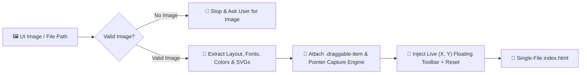

# Image to Interactive HTML (`image-to-interactive-html`)

> **Turn any static UI screenshot or mockup into a single-file, zero-dependency HTML prototype where every visual element can be freely dragged and repositioned on screen.**

[](#-installation)
[](#-key-features)
[](#-interactive-drag-engine)
[](#1-strict-input-validation-guardrail)
[](./LICENSE)

[Why This Exists](#-why-this-exists) · [Key Features](#-key-features) · [How It Works](#-how-it-works) · [Installation](#-installation) · [Usage & Prompts](#-usage--prompts) · [Repository Structure](#-repository-structure) · [ภาษาไทย (Thai Guide)](#-คู่มือการใช้งานภาษาไทย)

---

## 🎯 Why This Exists

When asking an AI coding agent to convert a UI screenshot into HTML/CSS, traditional prompts give you a **static layout**. If a badge is 8px too low, a button feels cramped, or a heading needs to be shifted to test visual balance, you have to go back and forth prompting the AI to tweak margins and paddings blindly.

**`image-to-interactive-html`** solves this by turning any reference image into an **interactive spatial canvas**:
1. **Pixel-Faithful Extraction:** Replicates exact colors, typography (including Thai fonts like `Prompt`/`Sarabun` and English `Inter`), inline SVG icons, shadows, and border radii.
2. **Every Element is Draggable:** Cards, buttons, badges, icons, headings, and body text are individually wired with `.draggable-item`.
3. **Independent Nested Dragging:** Drag a button *inside* a card without moving the card itself (`e.stopPropagation()`), or grab the card background to move the entire group.
4. **Live `(X, Y)` Coordinate Readout:** A non-intrusive floating toolbar in the top-right corner shows exact pixel offsets as you drag, plus a one-click **Reset Layout** button that smoothly animates everything back to `(0, 0)`.

---

## ✨ Key Features

| Feature | Description |
| :--- | :--- |
| **Strict Input Guardrail** | Refuses to hallucinate or guess a UI when no image attachment or valid image path (`.png`, `.jpg`, `.jpeg`, `.webp`, `.gif`) is provided. |
| **High-Fidelity Visual Replication** | Extracts verbatim text, casing, line breaks, hex/RGB colors, shadows, and recreates icons as clean inline SVGs. |
| **Independent Child & Parent Dragging** | Uses `pointerdown` event isolation so nested elements move independently from their parent containers. |
| **Desktop & Touch Ready** | Built on standard HTML5 Pointer Events (`pointerdown`, `pointermove`, `pointerup`, `setPointerCapture`) with `touch-action: none`. |
| **Live Floating Toolbar** | Displays real-time `X, Y` pixel delta offsets and includes a smooth cubic-bezier **Reset Layout** button. |
| **Single-File Architecture** | Outputs a 100% self-contained `.html` file (`<style>` + `<script>` embedded). Zero build steps required. |

---

## ⚙️ How It Works



### 1. Strict Input Validation (Guardrail)
If you invoke the skill with text only and forget to attach an image or specify a local image path, the agent **stops immediately** instead of inventing a random layout.

### 2. Visual Extraction & Fidelity
The agent inspects the image to match viewport backgrounds, card dimensions, border radii, drop shadows, exact hex/RGB values, and appropriate Google Fonts (`Inter`, `Prompt`, `Sarabun`).

### 3. Interactive Drag Engine
Every visual component receives `.draggable-item` powered by hardware-accelerated `translate3d(x, y, 0)` transforms:
- Hovering shows `cursor: grab`.
- Active dragging applies `cursor: grabbing`, elevates `z-index`, and adds a subtle focus ring + elevation shadow.
- Releasing preserves the element's `data-x` and `data-y` offset for subsequent drags.

---

## 📦 Installation

### Option 1: Install via `npx skills` CLI (Recommended)

Install globally for your coding agent (Antigravity, Claude Code, Cursor, Codex):

```bash
npx skills add <your-github-username>/image-to-interactive-html \
  --skill image-to-interactive-html \
  --global
```

### Option 2: Natural Language Install

Paste this directly into your AI coding agent:

```text
Install the image-to-interactive-html skill globally from https://github.com/<your-github-username>/image-to-interactive-html
```

### Option 3: Manual Installation

Clone or copy this folder into your agent's skills directory:

- **Google Antigravity / Gemini CLI (Global):**
  ```bash
  git clone https://github.com/<your-github-username>/image-to-interactive-html.git ~/.gemini/config/skills/image-to-interactive-html
  ```
- **Claude Code (Global):**
  ```bash
  git clone https://github.com/<your-github-username>/image-to-interactive-html.git ~/.claude/skills/image-to-interactive-html
  ```
- **Project-Level Workspace:**
  Place `SKILL.md` inside `.agents/skills/image-to-interactive-html/SKILL.md`.

---

## 🚀 Usage & Prompts

Attach a UI screenshot or provide a file path in your chat and prompt your agent:

```text
Use image-to-interactive-html on this screenshot and save it to index.html
```

```text
Convert ./mockups/checkout-card.png into an interactive draggable HTML prototype
```

```text
แปลงรูป UI ที่แนบมานี้เป็นไฟล์ Interactive HTML ที่ลากขยับแต่ละ Element ได้ด้วยสกิล image-to-interactive-html
```

---

## 📁 Repository Structure

```text
image-to-interactive-html/
├── SKILL.md                                    # Root skill definition (for direct git clone into skills/)
├── skills/
│   └── image-to-interactive-html/
│       └── SKILL.md                            # Standard package path for `npx skills add`
├── examples/
│   └── demo-interactive-ui.html                # Ready-to-open interactive HTML demo
├── LICENSE                                     # MIT License
└── README.md                                   # Documentation
```

---

## 🇹🇭 คู่มือการใช้งานภาษาไทย

**`image-to-interactive-html`** คือสกิลสำหรับสั่งให้ AI Agent แปลงรูปภาพ UI (จากไฟล์ที่แนบหรือ Path ในเครื่อง) ให้กลายเป็นไฟล์ HTML ไฟล์เดียว (`Single-File HTML`) ที่สามารถ **คลิกเมาส์ลากขยับ (Drag & Drop) ทุกชิ้นส่วนบนหน้าจอได้อย่างอิสระ** เพื่อช่วยในการจัดวางตำแหน่ง ปรับระยะห่าง และทดสอบ Layout ให้แม่นยำขึ้น

### จุดเด่นของสกิลนี้
1. **ป้องกันการมั่ว UI (Strict Guardrail):** หากเผลอพิมพ์คำสั่งโดยไม่ได้แนบรูปหรือระบุ Path รูปภาพ AI จะหยุดและเตือนให้แนบรูปก่อนทันที ไม่มโนหน้าเว็บขึ้นมาเอง
2. **ถอดแบบ UI ต้นฉบับแม่นยำ:** ดึงข้อความตามจริง 100% รองรับฟอนต์ภาษาไทย (`Prompt`, `Sarabun`) และภาษาอังกฤษ (`Inter`) พร้อมถอดสี Hex/RGB และสร้างไอคอนด้วย Inline SVG
3. **แยกการลากระดับลูกและแม่ (Nested Dragging):** สามารถลากเฉพาะปุ่มหรือข้อความข้างในการ์ดได้โดยที่ตัวการ์ดไม่ขยับตาม หรือจะลากที่พื้นหลังการ์ดเพื่อย้ายทั้งการ์ดก็ได้
4. **แถบเครื่องมือบอกพิกัดสด (Floating Toolbar):** แสดงค่าพิกัด `X, Y` ขณะลากแบบเรียลไทม์ที่มุมขวาบน พร้อมปุ่ม **Reset Layout** เพื่อดีดทุกชิ้นส่วนกลับตำแหน่งเริ่มต้น `(0, 0)` อย่างนุ่มนวล

---

## 📄 License

Released under the [MIT License](./LICENSE).
